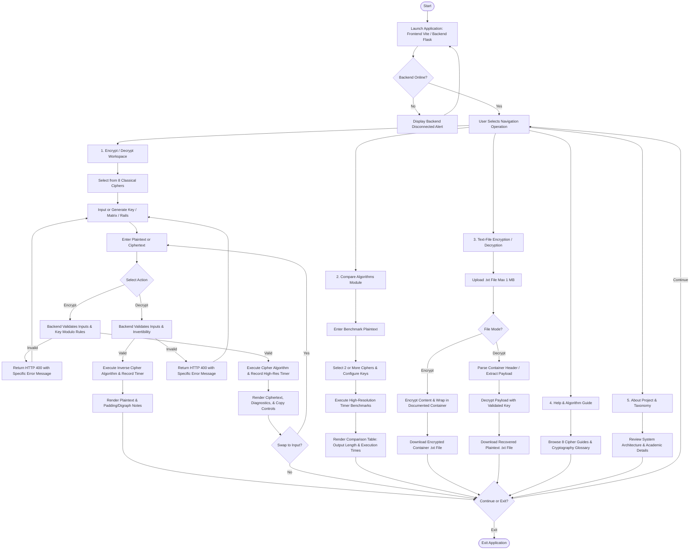

# System Architecture and Operational Flowchart

## Classical Cryptography Toolkit — Flowchart Specification

## Workflow Explanation

1. **Initialization:** The browser loads the React interface on `http://localhost:5173`. On startup, a health probe requests `GET /api/health` from the Flask server (`http://127.0.0.1:5000`). If unreachable, an alert banner advises the user to start the Flask backend.
2. **Operation Dispatch:** Users select among five modular environments: Encrypt/Decrypt Workspace, Multi-Algorithm Benchmark Comparison, Text-File Processing, Help/Algorithm Guide, or About Project.
3. **Validation Gateway:** All user inputs (Caesar shifts, 26-letter monoalphabetic keys, Playfair keywords, Hill 2×2 matrix invertibility mod 26, OTP keys matching length, Rail Fence counts, Columnar keywords) are validated on the Flask backend. Invalid configurations return explicit descriptive HTTP 400 responses.
4. **Execution and Telemetry:** High-resolution timing (`time.perf_counter()`) tracks cipher execution time in milliseconds. Results, transformations, and metadata (e.g., matrix inverses, determinants, zigzag lengths) are returned as structured JSON.
5. **Reversibility and Continuity:** Users can copy outputs, download files, swap ciphertext into the input area for immediate round-trip verification, or switch between modules seamlessly.
