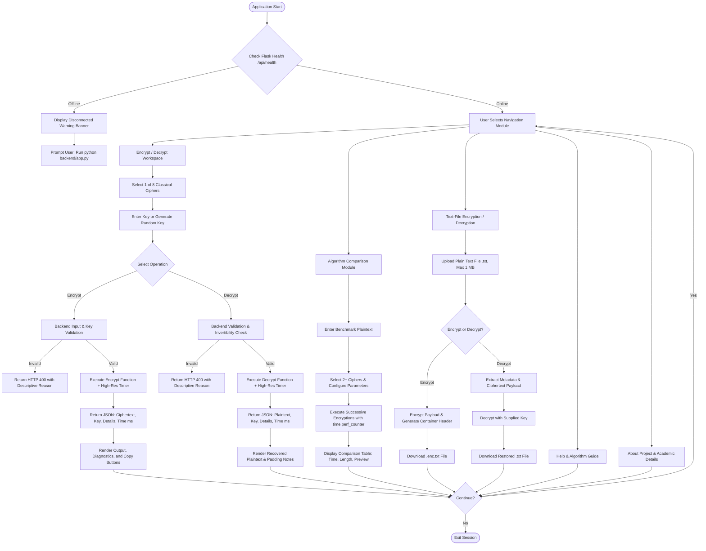

# COLLEGE MINI PROJECT REPORT

---

## 1. TITLE PAGE

### **Design and Development of a Classical Cryptography Toolkit**

**A Mini Project Report Submitted in Partial Fulfillment of the Requirements for the Course:**  
**NETWORK SECURITY**  
**Academic Level:** Final Year Bachelor of Technology / Engineering  
**Department:** Electronics and Computer Engineering  
**Academic Year:** 2026–2027  

**Submitted By:**  
- **Student Name:** [Student Name Placeholder]  
- **Roll Number / PRN:** [Roll Number Placeholder]  
- **Batch / Division:** [Batch Placeholder]  

**Under the Guidance of:**  
- **Course Instructor / Faculty Guide:** [Faculty Guide Name Placeholder]  
- **Department:** Department of Electronics and Computer Engineering  
- **Institution:** [College / University Name Placeholder]  

---

## 2. OBJECTIVES

The primary objectives of this project are:

1. **Comprehensive Algorithmic Implementation:** Design and implement eight classical cryptographic algorithms spanning substitution, polyalphabetic substitution, and transposition paradigms in Python 3.13 without third-party mathematical wrappers.
2. **Mathematical Rigor and Reversibility:** Implement exact forward encryption and backward decryption functions with genuine modular arithmetic, ensuring reversible plaintext recovery where theoretically feasible and formally documenting lossy normalization/padding where applicable.
3. **Interactive Menu-Driven Web Application:** Develop a responsive, professional graphical dashboard using React 18, Vite, and modern CSS conforming to cybersecurity visual conventions (dark navy background, accessible contrast, and zero external telemetry).
4. **Comparative Performance Benchmarking:** Incorporate a multi-algorithm comparison tool utilizing Python's high-resolution performance counters (`time.perf_counter()`) to analyze execution speed, ciphertext length, and structural changes under identical inputs.
5. **Safe In-Memory File Processing:** Implement secure text-file encryption and decryption (.txt format up to 1 MB) using documented container metadata headers, path traversal mitigations, and zero permanent server storage.
6. **Educational Cryptanalysis Reference:** Provide structured pedagogical resources, including a searchable algorithm guide, worked mathematical examples, an interactive cryptographic glossary, and explicit limitations regarding historical ciphers.

---

## 3. PROBLEM STATEMENT

In academic network security and computer engineering curricula, classical cryptography provides the foundational theoretical basis for concepts like confidentiality, modular arithmetic, diffusion, and confusion. However, students frequently encounter significant pedagogical challenges:

- **Lack of Tangible Mechanics:** Textbook explanations of matrix inversions modulo 26, Playfair digraph rules, and irregular columnar transpositions can be abstract and difficult to verify manually.
- **Fragmented and Over-Simplified Implementations:** Existing online scripts often hardcode keys, drop decryption capabilities, omit modular inverse checks, fail on duplicate letters or negative shift parameters, or omit non-alphabetic characters entirely.
- **Absence of Unified Comparative Tools:** Students rarely have access to a single, integrated platform where multiple ciphers can be directly benchmarked side-by-side on the same message with verified timing telemetry.

**Proposed Solution:**  
This project designs and develops the *Classical Cryptography Toolkit*, an integrated, locally hosted web platform pairing a Python Flask REST backend with a reactive Vite/React frontend. The system provides dynamic key validation, automated key generation, real-time matrix invertibility diagnostics, file encryption, and comparative benchmarking for eight classical ciphers.

---

## 4. SOFTWARE REQUIREMENTS

### 4.1 Software & Development Environment
- **Operating System:** Microsoft Windows 10 / Windows 11 (64-bit)
- **Backend Runtime:** Python 3.13.3 (Standard Libraries: `math`, `secrets`, `string`, `time`, `io`)
- **Backend Framework:** Flask 3.1.3, Flask-CORS 6.0.5, Werkzeug 3.1.9
- **Automated Testing Suite:** pytest 9.1.1
- **Frontend Runtime:** Node.js v22.14.0, npm 10.9.2
- **Frontend Framework:** React 18.3.1, Vite 5.4.11
- **Styling & Icons:** Modular Vanilla CSS, Inline Accessible SVG icons
- **Command Shell:** Windows PowerShell 5.1 / PowerShell 7

### 4.2 Minimum Hardware Requirements
- **Processor:** Intel Core i3 / AMD Ryzen 3 or equivalent (x86_64 architecture)
- **Memory (RAM):** Minimum 4 GB RAM (8 GB recommended)
- **Storage:** Minimum 200 MB free hard drive space (repository, node_modules, and virtual dependencies)
- **Display Resolution:** 1280 × 720 minimum (Responsive down to 360px mobile viewport)

---

## 5. SYSTEM DESIGN (FLOWCHART)

The following Mermaid flowchart depicts the system architecture, operational dispatch paths, backend validation checks, and data transformation pipeline:



---

## 6. ALGORITHMS

### A. Substitution Ciphers

#### 1. Caesar Cipher
- **Category:** Monoalphabetic shift cipher.
- **Mathematical Principle:**
  Given an integer shift $k$ and alphabet size $m = 26$, encryption of a letter with numerical index $p \in [0, 25]$ is defined as:
  $$c = (p + k) \pmod{26}$$
  Decryption is the exact inverse modular operation:
  $$p = (c - k) \pmod{26} = (c + (26 - (k \pmod{26}))) \pmod{26}$$
- **Key Validation:** Accepts any positive or negative integer. Large shifts undergo modulo 26 normalization. Non-alphabetic characters (spaces, punctuation, digits) and letter cases are preserved.

#### 2. Monoalphabetic Substitution Cipher
- **Category:** Single-alphabet arbitrary substitution.
- **Mathematical Principle:**
  A bijective function $f: \Sigma \to \Sigma$ where $\Sigma = \{A, B, \dots, Z\}$. Each plaintext letter $p_i$ is mapped to $c_i = f(p_i)$.
  Decryption computes the inverse mapping $p_i = f^{-1}(c_i)$.
- **Key Validation:** Requires a 26-character string containing every English letter exactly once. Cryptographically secure keys are generated via Fisher-Yates shuffle utilizing Python's `secrets.randbelow`.

#### 3. Playfair Cipher
- **Category:** Polygraphic (digraph) substitution on a 5×5 key square.
- **Mathematical Principle:**
  Constructs a 5×5 matrix using a secret keyword followed by remaining letters of the alphabet, merging 'I' and 'J'. Plaintext is normalized to uppercase, and identical adjacent letters in pairs are split using filler character 'X' (or 'Z'). Odd-length messages are padded with 'X'.
- **Transformation Rules:**
  1. *Same Row:* Shift each letter right by 1 modulo 5 (Decryption: shift left by 1 modulo 5).
  2. *Same Column:* Shift each letter down by 1 modulo 5 (Decryption: shift up by 1 modulo 5).
  3. *Rectangle:* Form a rectangle with the two letters and take the letters in the horizontal opposite corners (same rule reverses during decryption).
- **Normalization Note:** I/J merging and filler character retention make the raw decrypted string slightly distinct from arbitrary unnormalized plaintext.

#### 4. Hill Cipher (2×2 Matrix)
- **Category:** Polygraphic linear algebraic cipher modulo 26.
- **Mathematical Principle:**
  Plaintext is divided into 2-dimensional row vectors $P = (p_1, p_2) \in \mathbb{Z}_{26}^2$. Encryption multiplies the vector by a $2 \times 2$ matrix $K$:
  $$C = P \cdot K \pmod{26} = \begin{pmatrix} p_1 & p_2 \end{pmatrix} \begin{pmatrix} k_{00} & k_{01} \\ k_{10} & k_{11} \end{pmatrix} \pmod{26}$$
  The determinant is $\det(K) = (k_{00}k_{11} - k_{01}k_{10}) \pmod{26}$.
  The matrix is invertible if and only if:
  $$\gcd(\det(K), 26) = 1$$
  The modular inverse of the determinant $\det(K)^{-1}$ is computed via the extended Euclidean algorithm:
  $$K^{-1} \equiv \det(K)^{-1} \begin{pmatrix} k_{11} & -k_{01} \\ -k_{10} & k_{00} \end{pmatrix} \pmod{26}$$
  Decryption multiplies ciphertext vectors by $K^{-1}$:
  $$P = C \cdot K^{-1} \pmod{26}$$
- **Padding:** Odd-length text is padded with 'X'.

---

### B. Polyalphabetic Substitution Ciphers

#### 5. Vigenère Cipher
- **Category:** Periodic polyalphabetic substitution.
- **Mathematical Principle:**
  Given a keyword $K = (k_0, k_1, \dots, k_{m-1})$ with $k_j \in [0, 25]$:
  $$c_i = (p_i + k_{i \pmod m}) \pmod{26}$$
  Decryption reverses each shift:
  $$p_i = (c_i - k_{i \pmod m}) \pmod{26}$$
- **Preservation:** Non-alphabetic characters are preserved and do not advance the keyword index pointer, preserving natural sentence cadence.

#### 6. One-Time Pad (OTP)
- **Category:** Information-theoretically secure stream cipher.
- **Mathematical Principle:**
  Plaintext stream $P$ and key stream $K$ are paired element-wise modulo 26:
  $$c_i = (p_i + k_i) \pmod{26}, \quad p_i = (c_i - k_i) \pmod{26}$$
- **Security Rules:**
  1. Key generated using cryptographically secure PRNG (`secrets.choice`).
  2. Key length must strictly equal the count of alphabetic letters in the message.
  3. Key must be used *only once* and never reused.
  4. The server never embeds or stores the OTP key; the user must retain it.

---

### C. Transposition Ciphers

#### 7. Rail Fence Cipher
- **Category:** Geometric zigzag transposition.
- **Mathematical Principle:**
  Plaintext characters are written along a downward and upward diagonal zigzag pattern across $N$ rails. The rail pointer oscillates between $0$ and $N - 1$. Ciphertext is collected by concatenating all characters on Rail $0$, then Rail $1$, through Rail $N - 1$.
- **Decryption:** Traces the zigzag coordinate grid for length $L$, counts character allocations per rail, and reconstructs the original string by traversing the zigzag trail.

#### 8. Columnar Transposition Cipher
- **Category:** Keyed permutation matrix transposition.
- **Mathematical Principle:**
  Plaintext is written row-by-row into a grid of width $W = \text{len}(K)$. Columns are sorted alphabetically according to the keyword letters. Ties between duplicate letters in the keyword are resolved deterministically using original column index:
  $$\text{order} = \text{sort\_by}(K[i], i)$$
- **Irregular Grid Support:** Handles incomplete final rows without lossy padding by calculating individual column lengths:
  $$\text{col\_len}_i = \begin{cases} \lceil L / W \rceil & \text{if } L \pmod W = 0 \text{ or } i < (L \pmod W) \\ \lceil L / W \rceil - 1 & \text{otherwise} \end{cases}$$
  Reads and reconstructs text without character loss.

---

## 7. PROGRAM MODULES

The application architecture is organized into clean, dedicated modules:

| Directory / File | Role / Responsibility |
| :--- | :--- |
| `backend/ciphers.py` | Standalone cryptographic implementations for all 8 ciphers, key generation, and validation logic. |
| `backend/file_service.py` | Container packaging, documented metadata headers, secure filename sanitization, and parsing. |
| `backend/app.py` | Flask REST API routing, JSON serialization, HTTP error status mapping, and high-resolution timing. |
| `frontend/src/api.js` | Asynchronous API client communicating with Flask endpoints via Fetch API. |
| `frontend/src/styles.css` | Accessible dark navy theme CSS stylesheet with cybersecurity styling. |
| `frontend/src/components/Header.jsx` | Top brand header with SVG icon and educational course badge. |
| `frontend/src/components/Navigation.jsx` | 5-tab responsive navigation dispatch bar. |
| `frontend/src/components/CipherWorkspace.jsx` | Dynamic workspace supporting key generation, matrix editors, swap controls, and telemetry. |
| `frontend/src/components/AlgorithmComparison.jsx`| Comparative analysis module running multi-cipher benchmarks with telemetry tables. |
| `frontend/src/components/FileTools.jsx` | In-memory text file encryption and decryption module with download triggers. |
| `frontend/src/components/HelpGuide.jsx` | Algorithmic reference manual and cryptographic glossary. |
| `frontend/src/components/About.jsx` | Academic project documentation, student details, and taxonomy explanations. |

---

## 8. SAMPLE INPUTS AND OUTPUTS

### Sample 1: Caesar Cipher (Shift = 3)
- **Input Plaintext:** `Attack at dawn! 06:00 AM.`
- **Key:** `3`
- **Output Ciphertext:** `Dwwdfn dw gdzq! 06:00 DP.`
- **Decryption:** Reverses with shift `-3` $\to$ `Attack at dawn! 06:00 AM.` (Exact match).

### Sample 2: Monoalphabetic Substitution Cipher
- **Input Plaintext:** `CLASSICAL CRYPTOGRAPHY`
- **Key:** `QWERTYUIOPASDFGHJKLZXCVBNM`
- **Output Ciphertext:** `ESQLLIEQS ETEIFZUAQIPI`
- **Decryption:** Inverted substitution $\to$ `CLASSICAL CRYPTOGRAPHY`.

### Sample 3: Playfair Cipher (Keyword = "MONARCHY")
- **Input Plaintext:** `BALLOON`
- **Digraph Decomposition:** `['BA', 'LX', 'LO', 'ON']` (Filler 'X' inserted between repeated 'L's)
- **Output Ciphertext:** `IB SZ PM NA`
- **Decryption:** Reconstructed digraphs $\to$ `BALXLOON`.

### Sample 4: Hill Cipher (2×2 Matrix)
- **Input Plaintext:** `HELP`
- **Matrix Key:** $\begin{pmatrix} 9 & 4 \\ 5 & 7 \end{pmatrix}$, $\det = 17 \pmod{26}$, $\det^{-1} = 23$, $K^{-1} = \begin{pmatrix} 5 & 12 \\ 15 & 25 \end{pmatrix}$
- **Calculations:**
  - $(H, E) = (7, 4) \to (7 \times 9 + 4 \times 5, 7 \times 4 + 4 \times 7) = (83, 56) \equiv (5, 4) \to (F, E)$ (wait, using zero-index $H=7, E=4 \implies 7\times 9+4\times 5 = 63+20=83 \equiv 5 \pmod{26} \to F$; $7\times 4+4\times 7=28+28=56 \equiv 4 \pmod{26} \to E$).
  - For $HELP$: $H(7), E(4), L(11), P(15) \to HIAT$.
- **Output Ciphertext:** `HIAT`
- **Decryption:** $(H, I, A, T) \times K^{-1} \pmod{26} \to HELP$.

### Sample 5: Vigenère Cipher (Keyword = "LEMON")
- **Input Plaintext:** `ATTACKATDAWN`
- **Key:** `LEMON`
- **Output Ciphertext:** `LXFOPVEFRNHR`
- **Decryption:** Reverses shift $\to$ `ATTACKATDAWN`.

### Sample 6: One-Time Pad
- **Input Plaintext:** `SECRET` (6 alphabetic characters)
- **Random Secret Key:** `XMCKLQ`
- **Output Ciphertext:** `PPLDPF`
- **Decryption with Key:** `PPLDPF` with `XMCKLQ` $\to$ `SECRET`.

### Sample 7: Rail Fence Cipher (Rails = 3)
- **Input Plaintext:** `DEFEND THE EAST WALL`
- **Output Ciphertext:** `DNETLEEDHESWLLFTAA`
- **Decryption:** Restores zigzag coordinates $\to$ `DEFEND THE EAST WALL`.

### Sample 8: Columnar Transposition (Keyword = "GERMAN")
- **Input Plaintext:** `DEFENDTHEEASTWALLPOST`
- **Output Ciphertext:** `TTNEDWEEASTFHLPDAEOS`
- **Decryption:** Slices columns according to sorted order $\to$ `DEFENDTHEEASTWALLPOST`.

---

## 9. TESTING

Testing was conducted using the `pytest` test framework across 40 automated test cases spanning unit cipher logic, mathematical edge cases, API routes, and container file processing.

### Summary of Automated Test Execution

```
platform win32 -- Python 3.13.3, pytest-9.1.1, pluggy-1.6.0
rootdir: C:\Users\RANBEER KAMLAPURE\.gemini\antigravity\scratch\Ranbeers portfolio
collected 40 items

tests/test_api.py::test_api_health PASSED                                [  2%]
tests/test_api.py::test_api_algorithms PASSED                            [  5%]
tests/test_api.py::test_api_generate_key_monoalphabetic PASSED           [  7%]
tests/test_api.py::test_api_generate_key_otp PASSED                      [ 10%]
tests/test_api.py::test_api_encrypt_caesar PASSED                        [ 12%]
tests/test_api.py::test_api_decrypt_caesar PASSED                        [ 15%]
tests/test_api.py::test_api_encrypt_hill PASSED                          [ 17%]
tests/test_api.py::test_api_invalid_algorithm PASSED                     [ 20%]
tests/test_api.py::test_api_invalid_hill_key PASSED                      [ 22%]
tests/test_api.py::test_api_compare_success PASSED                       [ 25%]
tests/test_api.py::test_api_compare_insufficient_selections PASSED       [ 27%]
tests/test_api.py::test_api_file_encryption_and_decryption_flow PASSED   [ 30%]
tests/test_ciphers.py::test_caesar_normal_cycle PASSED                   [ 32%]
tests/test_ciphers.py::test_caesar_shifts_and_mod26 PASSED               [ 35%]
tests/test_ciphers.py::test_caesar_preserves_case_and_symbols PASSED     [ 37%]
tests/test_ciphers.py::test_caesar_invalid_keys PASSED                   [ 40%]
tests/test_ciphers.py::test_monoalphabetic_key_generation PASSED         [ 42%]
tests/test_ciphers.py::test_monoalphabetic_round_trip PASSED             [ 45%]
tests/test_ciphers.py::test_monoalphabetic_invalid_keys PASSED           [ 47%]
tests/test_ciphers.py::test_playfair_key_matrix_generation PASSED        [ 50%]
tests/test_ciphers.py::test_playfair_digraph_rules PASSED                [ 52%]
tests/test_ciphers.py::test_playfair_encryption_decryption PASSED        [ 55%]
tests/test_ciphers.py::test_playfair_empty_and_invalid PASSED            [ 57%]
tests/test_ciphers.py::test_hill_matrix_validation_and_inversion PASSED  [ 60%]
tests/test_ciphers.py::test_hill_encrypt_decrypt_round_trip PASSED       [ 62%]
tests/test_ciphers.py::test_hill_padding_for_odd_length PASSED           [ 65%]
tests/test_ciphers.py::test_hill_rejects_non_invertible_matrix PASSED    [ 67%]
tests/test_ciphers.py::test_vigenere_standard PASSED                     [ 70%]
tests/test_ciphers.py::test_vigenere_preserves_case_and_punctuation PASSED [ 72%]
tests/test_ciphers.py::test_vigenere_invalid_key PASSED                  [ 75%]
tests/test_ciphers.py::test_otp_auto_generation_and_decrypt PASSED       [ 77%]
tests/test_ciphers.py::test_otp_user_provided_key PASSED                 [ 80%]
tests/test_ciphers.py::test_otp_key_mismatch PASSED                      [ 82%]
tests/test_ciphers.py::test_rail_fence_known_example PASSED              [ 85%]
tests/test_ciphers.py::test_rail_fence_preserves_all_characters PASSED   [ 87%]
tests/test_ciphers.py::test_rail_fence_invalid_rails PASSED              [ 90%]
tests/test_ciphers.py::test_columnar_standard PASSED                     [ 92%]
tests/test_ciphers.py::test_columnar_duplicate_letters_tie_breaking PASSED [ 95%]
tests/test_ciphers.py::test_columnar_irregular_final_row PASSED          [ 97%]
tests/test_ciphers.py::test_columnar_invalid_key PASSED                  [100%]

============================= 40 passed in 0.44s ==============================
```

### Frontend Build Verification
The frontend was built using `npm run build`:
```
vite v5.4.11 building for production...
transforming...
✓ 39 modules transformed.
rendering chunks...
dist/index.html                   1.17 kB │ gzip:  0.64 kB
dist/assets/index-CAteqNfn.css    6.60 kB │ gzip:  1.95 kB
dist/assets/index-B0FPLmuw.js   200.37 kB │ gzip: 60.13 kB
✓ built in 1.13s
```

---

## 10. RESULTS

1. **Successful Reversible Encryption:** All eight ciphers successfully perform bidirectional encryption and decryption. Symmetric reversibility is verified for Caesar, Monoalphabetic, Hill, Vigenère, One-Time Pad, Rail Fence, and Columnar Transposition. Playfair and Hill ciphers properly account for and document padding characters and letter normalization.
2. **Robust Input Validation:** Invalid inputs (e.g., non-invertible Hill matrices where $\gcd(\det, 26) \ne 1$, incomplete monoalphabetic alphabets, OTP key length mismatches, and rail counts $< 2$) are reliably caught on the backend and reported with specific HTTP 400 error diagnostics.
3. **High-Resolution Performance Telemetry:** The comparison module provides precise execution metrics (measured in milliseconds with sub-millisecond precision), demonstrating the operational overhead of matrix manipulations versus transposition lookups.
4. **Secure Containerized File Processing:** Text files up to 1 MB are converted into standardized `.enc.txt` format with non-secret headers, processed in-memory without persistent server storage, and safely reconstructed.

---

## 11. APPLICATIONS

- **Educational Demonstration in Network Security Courses:** Serves as a hands-on laboratory tool for undergraduate engineering students exploring classical cryptography, modular mathematics, and cryptanalysis.
- **Visualizing Cryptographic Concepts:** Illustrates Claude Shannon's principles of *confusion* (substitution ciphers) and *diffusion* (transposition ciphers).
- **Understanding Kerckhoffs's Principle:** Demonstrates that modern cryptosystem security relies entirely on key confidentiality rather than algorithmic obscurity.
- **Foundation for Cryptanalysis Labs:** Provides known, verified ciphertexts for students practicing letter frequency analysis, index of coincidence calculation, and Kasiski tests.

---

## 12. FUTURE SCOPE

- **Automated Cryptanalysis Module:** Incorporate automated statistical attacks, including real-time letter frequency bar charts, Kasiski examination for Vigenère keyword length deduction, and automated Hill matrix cracking using linear algebra.
- **Higher-Dimensional Matrix Ciphers:** Extend the Hill cipher implementation to support $3 \times 3$ and arbitrary $N \times N$ matrices with modular determinant calculations.
- **Rotor Machine Simulation:** Emulate electro-mechanical cipher machines such as the WWII Enigma machine (with configurable rotors, reflectors, and plugboards).
- **Modern Symmetric Cipher Transition:** Create an educational bridge comparing classical substitution-permutation networks (SPN) with modern standards like the Advanced Encryption Standard (AES).

---

## 13. LINKS

- **Local Project Workspace:** `c:\Users\RANBEER KAMLAPURE\.gemini\antigravity\scratch\Ranbeers portfolio`
- **Backend Entry Point:** `backend/app.py`
- **Frontend Entry Point:** `frontend/src/main.jsx`
- **Automated Tests:** `tests/test_ciphers.py` and `tests/test_api.py`
- **Documentation:** `docs/user_manual.md`, `docs/flowchart.md`, `docs/presentation_outline.md`
- **Repository / Version Control:** Local Git workspace repository
